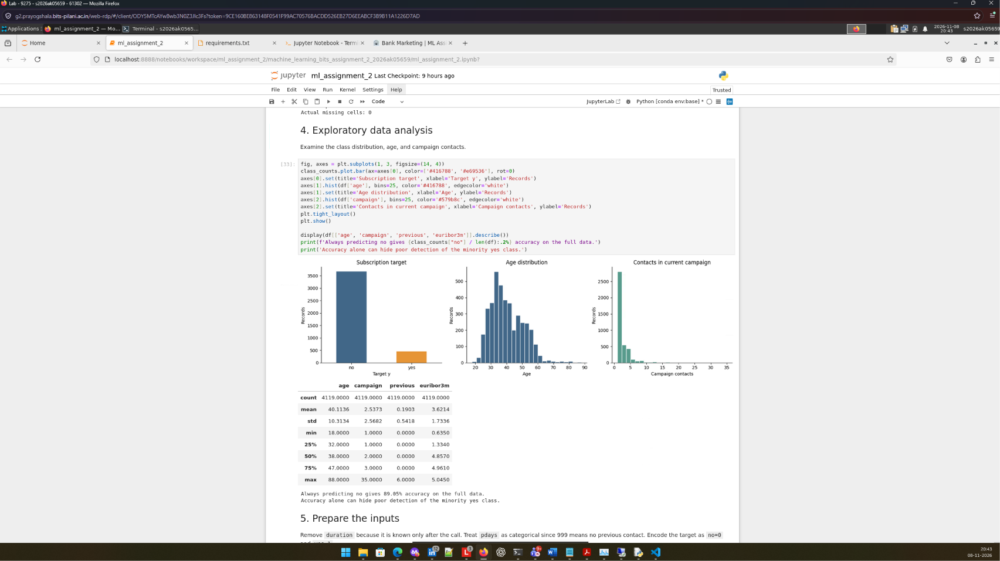
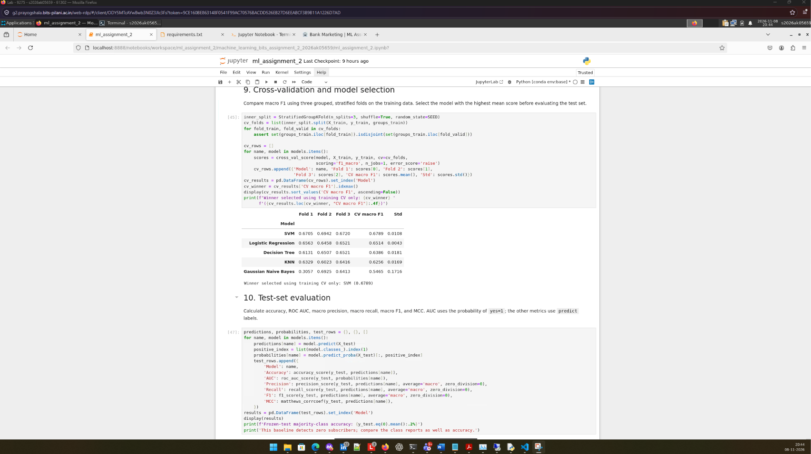
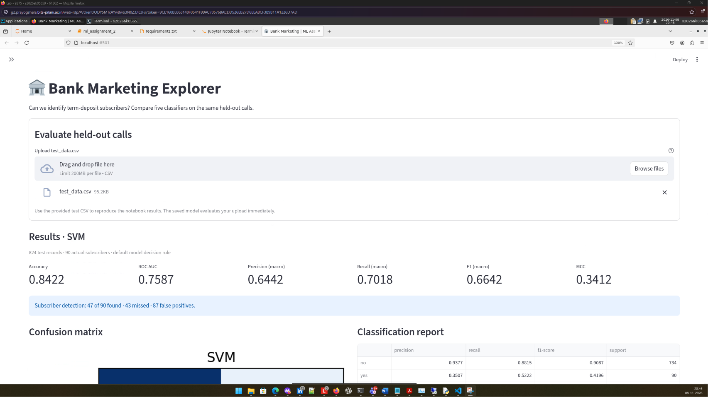

# Machine Learning Assignment 2 — Bank Marketing

Name:   Tony Baby   
BITSID: **2026ak05659**

## a. Problem statement

Predict whether a client will subscribe to a bank term deposit using information available before the call outcome. Compare five classification models and evaluate their saved pipelines through a Streamlit application.

## b. Dataset description

**Source:** [UCI Bank Marketing](https://archive.ics.uci.edu/dataset/222/bank+marketing), `bank-additional.csv`.

- **Records:** 4,119
- **Original predictors:** 20
- **Target:** `y`, encoded as no = 0 and yes = 1
- **Class distribution:** 3,668 no and 451 yes
- **CSV delimiter:** semicolon

The `duration` feature is removed because it is known only after the call, leaving **19 predictors**:

- **Numeric (8):** `age`, `campaign`, `previous`, `emp.var.rate`, `cons.price.idx`, `cons.conf.idx`, `euribor3m`, `nr.employed`.
- **Categorical (11):** `job`, `marital`, `education`, `default`, `housing`, `loan`, `contact`, `month`, `day_of_week`, `poutcome`, `pdays`.

`pdays` is treated as categorical because 999 means no previous contact. Literal `unknown` categories are preserved. There are no empty cells or duplicate full rows. After removing `duration`, 20 predictor rows repeat; these are grouped during splitting.

Dataset citation: Moro, S., Rita, P., and Cortez, P. (2014). *Bank Marketing*. UCI Machine Learning Repository. [doi:10.24432/C5K306](https://doi.org/10.24432/C5K306). CC BY 4.0.

## c. GitHub repository link

[machine_learning_bits_assignment_2_2026ak05659](https://github.com/upazrotr/machine_learning_bits_assignment_2_2026ak05659)

**Live Streamlit app:** [here](https://machinelearningbitsassignment22026ak05659-aerwsgd8sn5tmjfdarp4.streamlit.app/)

## d. Models used

| Model | Settings |
|---|---|
| Logistic Regression | `max_iter=2000`, `class_weight="balanced"` |
| Decision Tree | `max_depth=6`, `min_samples_leaf=10`, `class_weight="balanced"` |
| KNN | `n_neighbors=11` |
| Gaussian Naive Bayes | Default settings |
| SVM | RBF kernel, `probability=True`, `class_weight="balanced"` |

The random seed is **346234**, including estimators that support `random_state`.

### Preprocessing and evaluation

Numeric features use median imputation and standard scaling. Categorical features use most-frequent imputation and dense one-hot encoding with `handle_unknown="ignore"`. Each classifier has a complete preprocessing-and-model pipeline.

Inputs are ordered as numeric features followed by categorical features, with `pdays` converted to text before hashing. The first fold of a shuffled five-fold `StratifiedGroupKFold` provides **3,295 training rows** and **824 test rows**. The test set contains 734 non-subscribers and 90 subscribers.

Three-fold grouped, stratified cross-validation uses training data only, with preprocessing fitted within each fold. The winner is selected by mean CV macro F1 before test evaluation. Identical predictor rows stay in the same partition; this does not establish customer-level independence.

| Model | CV macro F1 | Standard deviation |
|---|---:|---:|
| Logistic Regression | 0.6514 | 0.0043 |
| Decision Tree | 0.6386 | 0.0181 |
| KNN | 0.6256 | 0.0169 |
| Gaussian Naive Bayes | 0.5465 | 0.1716 |
| **SVM** | **0.6789** | **0.0108** |

### Test results

Precision, recall, and F1 use **macro averaging**. AUC uses positive-class probabilities. The other metrics use each model's `predict` labels.

| ML Model Name | Accuracy | AUC | Precision | Recall | F1 | MCC |
|---|---:|---:|---:|---:|---:|---:|
| Logistic Regression | 0.8216 | 0.7590 | 0.6363 | 0.7244 | 0.6590 | 0.3498 |
| Decision Tree | 0.7828 | 0.7279 | 0.6083 | 0.7026 | 0.6224 | 0.2963 |
| KNN | 0.8944 | 0.6899 | 0.7404 | 0.5557 | 0.5727 | 0.2314 |
| Gaussian Naive Bayes | 0.7864 | 0.7459 | 0.6087 | 0.6998 | 0.6235 | 0.2948 |
| SVM | 0.8422 | 0.7587 | 0.6442 | 0.7018 | 0.6642 | 0.3412 |

### Model observations

| Model | Observation |
|---|---|
| Logistic Regression | Detects 54 of 90 subscribers, with 111 false positives. It achieves the highest test AUC (0.7590) and MCC (0.3498), providing a useful balance between subscriber detection and false positives. |
| Decision Tree | Detects 54 subscribers but produces 143 false positives. Its rules are interpretable, though its test macro F1 (0.6224) is lower than Logistic Regression. |
| KNN | Has the highest accuracy (89.44%) but detects only 11 subscribers, missing 79. Its low subscriber recall (12.22%) shows why accuracy alone is misleading. |
| Gaussian Naive Bayes | Detects 53 subscribers, with 139 false positives. Its CV macro F1 varies from 0.3057 to 0.6925. Gaussian and independence assumptions are imperfect for correlated one-hot features. |
| SVM | Achieves the highest CV and test macro F1. It detects 47 subscribers with 87 false positives, reducing false positives compared with Logistic Regression while missing seven more subscribers. |
| **Overall winner: SVM** | Selected using training CV macro F1 of **0.6789**, with test macro F1 of **0.6642**. Its small test advantage over Logistic Regression does not establish statistical superiority. |

Predicting `no` for every test record already gives **89.08% accuracy** while detecting no subscribers. Macro F1, MCC, and subscriber recall provide a more useful assessment of this imbalanced target. The recall column in the comparison table is macro recall; subscriber recall appears in the classification reports.

### EXECUTION

**EDA**

**MODEL COMPARISON**
 

**STREAMLIT LOCAL**
